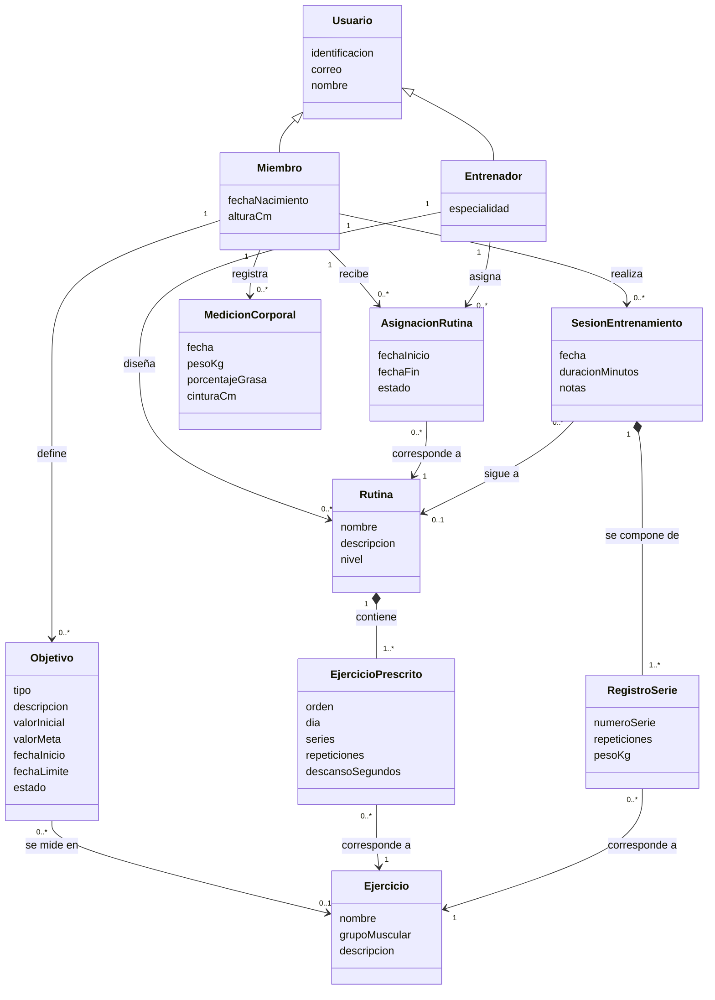

# Modelo de dominio de GymTrack

Refinamiento del modelo conceptual (Bloque 2 → Bloque 3): conceptos + atributos + relaciones con nombre + multiplicidades justificadas.
**Sin métodos, controladores, servicios ni tablas** (eso pertenece al diseño). Estilo equivalente al ejemplo `Estudiante – Prestamo – Ejemplar`.

## 1. Conceptos y cómo se descubrieron (técnica de sustantivos + lenguaje del negocio)

| Concepto | Qué es | ¿Atributo o concepto? |
|---|---|---|
| Usuario | Persona que usa GymTrack | Concepto (identidad propia). Es la generalización de Miembro y Entrenador. |
| Miembro | Usuario que entrena | Concepto. |
| Entrenador | Usuario que diseña y asigna rutinas | Concepto. |
| Objetivo | Meta medible de un miembro | Concepto: tiene estado, fechas y se relaciona con el miembro y, a veces, con un ejercicio. |
| Ejercicio | Movimiento del catálogo (ej. *Press de banca*) | Concepto: tiene identidad y lo usan rutinas, series y objetivos. Es la "obra" (como Libro). |
| Rutina | Plan de entrenamiento diseñado por un entrenador | Concepto. |
| EjercicioPrescrito | Un ejercicio dentro de una rutina, con series/repeticiones/descanso | Concepto dependiente de la rutina (como DetalleRenovacion). |
| AsignacionRutina | Hecho de que una rutina se asigna a un miembro durante un periodo | Concepto: tiene fechas y estado propios (como Prestamo entre Estudiante y Ejemplar). |
| SesionEntrenamiento | Un entrenamiento realizado en una fecha | Concepto. |
| RegistroSerie | Una serie realizada (repeticiones y peso) de un ejercicio | Concepto dependiente de la sesión. |
| MedicionCorporal | Medida del cuerpo en una fecha | Concepto: se consulta y compara en el tiempo. |

**Descartados como conceptos** (Bloque 2, "detectemos los errores"): `Panel de progreso`, `Gráfica`, `Botón guardar` (interfaz de usuario);
`ObjetivoController`, `RutinaService` (elementos de software); `MongoDB` (tecnología). Tampoco es concepto el **progreso**:
es un valor **derivado** (RN-07), no una información que alguien registre.

**Atributo y no concepto:** `grupoMuscular` y `nivel` describen a Ejercicio y Rutina y no tienen relaciones propias → atributos (con valores acotados).

## 2. Atributos

| Concepto | Atributos |
|---|---|
| Usuario | identificacion, nombre, correo |
| Miembro | fechaNacimiento, alturaCm |
| Entrenador | especialidad |
| Objetivo | tipo, descripcion, valorInicial, valorMeta, fechaInicio, fechaLimite, estado |
| Ejercicio | nombre, grupoMuscular, descripcion |
| Rutina | nombre, descripcion, nivel |
| EjercicioPrescrito | orden, dia, series, repeticiones, descansoSegundos |
| AsignacionRutina | fechaInicio, fechaFin, estado |
| SesionEntrenamiento | fecha, duracionMinutos, notas |
| RegistroSerie | numeroSerie, repeticiones, pesoKg |
| MedicionCorporal | fecha, pesoKg, porcentajeGrasa, cinturaCm |

## 3. Relaciones y multiplicidades justificadas

Cada fila se lee como una frase del negocio. La columna *Regla* es la que justifica la multiplicidad (no se inventan).

| # | Relación | Tipo | Multiplicidades | Regla que la justifica |
|---|---|---|---|---|
| 1 | Usuario ◁— **Miembro** / **Entrenador** | Herencia ("es un") | *(sin multiplicidades)* | RN-02: ambos son tipos de usuario, comparten identidad/correo y un Miembro o Entrenador puede usarse donde se espera un Usuario. No se hereda solo por compartir atributos. |
| 2 | Miembro **define** Objetivo | Asociación | Miembro `1` — `0..*` Objetivo | RN-03: un objetivo pertenece a un único miembro; un miembro puede no tener ninguno. |
| 3 | Objetivo **se mide en** Ejercicio | Asociación | Objetivo `0..*` — `0..1` Ejercicio | RN-05: solo los objetivos de fuerza referencian un ejercicio; un ejercicio puede ser meta de muchos objetivos. |
| 4 | Entrenador **diseña** Rutina | Asociación | Entrenador `1` — `0..*` Rutina | RN-09: toda rutina la crea exactamente un entrenador; un entrenador puede no haber creado ninguna. |
| 5 | Rutina **contiene** EjercicioPrescrito | **Composición** | Rutina `1` ◆— `1..*` EjercicioPrescrito | RN-09/RN-10: la rutina exige al menos un ejercicio prescrito y este nace y muere con ella (¿ciclo de vida independiente? No). |
| 6 | EjercicioPrescrito **corresponde a** Ejercicio | Asociación | `0..*` — `1` | RN-09: cada ejercicio prescrito es de un ejercicio del catálogo, que existe sin rutinas. |
| 7 | Miembro **recibe** AsignacionRutina | Asociación | Miembro `1` — `0..*` AsignacionRutina | RN-11: un miembro acumula asignaciones en el tiempo (una sola activa). |
| 8 | Entrenador **asigna** AsignacionRutina | Asociación | Entrenador `1` — `0..*` AsignacionRutina | RN-12: la asigna un entrenador existente. |
| 9 | AsignacionRutina **corresponde a** Rutina | Asociación | `0..*` — `1` | RN-12: una rutina puede asignarse a muchos miembros y nunca a ninguno. |
| 10 | Miembro **realiza** SesionEntrenamiento | Asociación | Miembro `1` — `0..*` Sesion | RN-13: cada sesión es de un miembro; puede no haber sesiones aún. |
| 11 | SesionEntrenamiento **sigue a** Rutina | Asociación | Sesion `0..*` — `0..1` Rutina | RN-14: la sesión puede ser libre (0) o seguir una rutina (1). |
| 12 | SesionEntrenamiento **se compone de** RegistroSerie | **Composición** | Sesion `1` ◆— `1..*` RegistroSerie | RN-13: una sesión se registra con al menos una serie, que no existe sin ella. |
| 13 | RegistroSerie **corresponde a** Ejercicio | Asociación | `0..*` — `1` | RN-13: cada serie es de un ejercicio del catálogo. |
| 14 | Miembro **registra** MedicionCorporal | Asociación | Miembro `1` — `0..*` Medicion | RN-15/RN-16: las mediciones pertenecen a un miembro; puede no tener ninguna. |

**Agregación:** no aparece. Ninguna relación es "tiene, pero no controla su existencia" distinta de una asociación;
no se fuerza una agregación solo porque el código tenga una colección (Bloque 5).

**Interfaz de diseño (no es concepto de dominio):** `EstrategiaProgreso`, que aparece en la vista lógica de diseño (RN-07).

## 4. Diagrama

> Versión formal en Visual Paradigm: vista lógica, diagrama de clases (`diagramas/exportados/3-logica-clases.png`). Ese diagrama añade tipos de dato y operaciones a este mismo modelo; este documento conserva la versión conceptual (solo atributos, sin métodos), que es la que pide el Bloque 3.

## 5. Verificación (checklist del Bloque 3)

* ¿Cada concepto tiene significado claro? ✔
* ¿Los atributos son relevantes (no columnas de BD)? ✔ — sin identificadores técnicos ni claves foráneas.
* ¿Las relaciones se leen como frases del negocio? ✔ (columna *Relación*).
* ¿Las multiplicidades están justificadas? ✔ (columna *Regla*).
* ¿Hay métodos, controladores o tablas? ✘ — correcto, todavía no.
