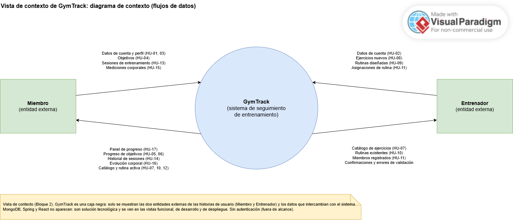
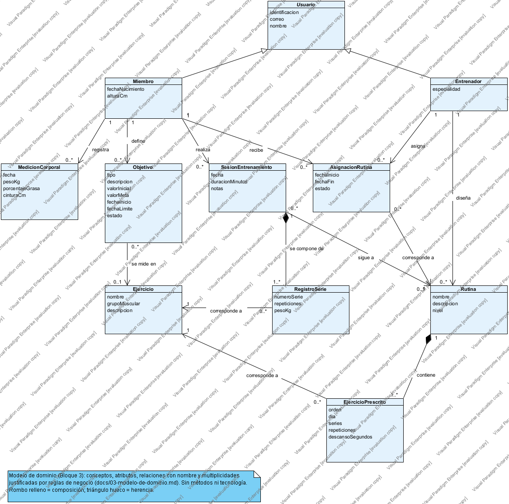
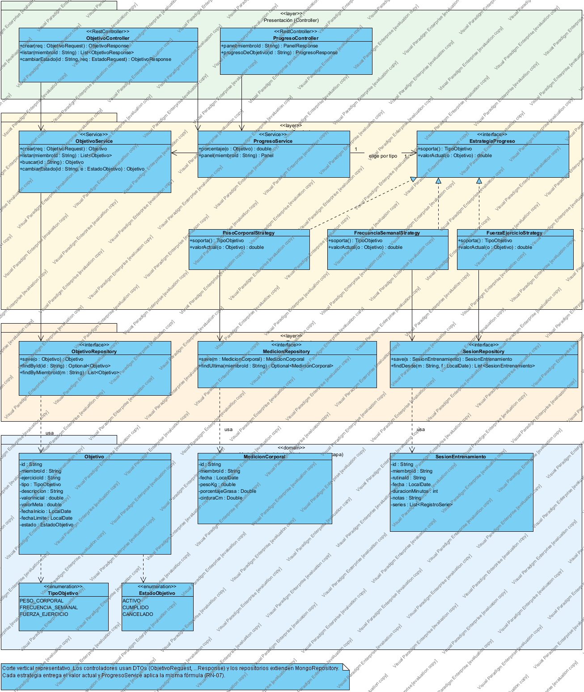
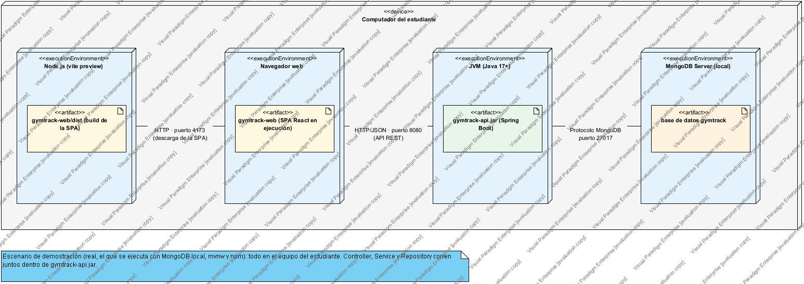

# Vistas arquitectónicas de GymTrack

Cinco vistas construidas en **Visual Paradigm** (`../diagramas/gymtrack.vpp`, 7 diagramas). Cada una responde una pregunta distinta,
se verifica contra las reglas de `00-reglas-de-la-materia.md` y se relaciona con las demás por trazabilidad (HU → componente → clase → artefacto).

> Las imágenes de `../diagramas/exportados/` llevan la marca de agua *evaluation copy* porque Visual Paradigm corre en modo evaluación
> desde la línea de comandos. Para imágenes limpias, abre `gymtrack.vpp` con tu licencia y exporta (ver `../diagramas/README.md`).

| # | Vista | Diagrama UML | Archivo |
|---|---|---|---|
| 1 | Contexto | Casos de uso (sistema como caja negra) | `1-contexto.png` |
| 2 | Funcional | Componentes | `2-funcional.png` |
| 3 | Lógica | Clases: **3a** modelo de dominio y **3b** diseño por capas | `3a-logica-dominio.png`, `3b-logica-capas.png` |
| 4 | Desarrollo | Paquetes | `4-desarrollo.png` |
| 5 | Despliegue | Despliegue: **5a** demostración local y **5b** escenario objetivo | `5a-…png`, `5b-…png` |

---

## 1. Vista de contexto — ¿quién interactúa con el sistema?

* **Decisión:** GymTrack es una caja negra; solo se muestran los dos actores de las historias (**Miembro**, **Entrenador**) y nueve capacidades observables
  (con sus HU). Se expresa con un diagrama de casos de uso a nivel de épica.
* **No aparecen** MongoDB ni Spring: son *solución tecnológica*, no contexto del negocio (Bloque 2: «Del dominio» vs. «Solución tecnológica»).
  Entran en las vistas funcional y de despliegue.
* **Fuera del contexto:** sin autenticación (decisión declarada en `01-caso-de-estudio.md`).
* ⚠️ El material no define esta vista formalmente: se usa UML estándar y la decisión queda declarada.

| Verificación | |
|---|---|
| Actores = los de las historias de usuario | ✔ |
| Sin estructura interna ni tecnología | ✔ |
| Cada capacidad cita sus HU (17 de 17 cubiertas) | ✔ |

## 2. Vista funcional — ¿qué partes funcionales forman la solución?

* **Siete componentes** cohesivos dentro de «GymTrack API (una sola JVM)»; cada uno agrupa las HU que resuelve (Bloque 5: de clases a componentes).
* **Dependencias** (cliente → proveedor): Progreso → {Objetivos, Entrenamientos, Rutinas, Mediciones}; Objetivos, Entrenamientos, Rutinas → {Usuarios, Catálogo};
  Entrenamientos → Rutinas (rutina opcional de una sesión, RN-14); Mediciones → Usuarios. El grafo es **acíclico**.
* **Límites del sistema:** SPA → API por *HTTP/JSON (REST)*; API → MongoDB (sistema externo, «persiste documentos»).
* El recuadro de la API lo deja explícito: **las capas lógicas no son servidores**; todo corre en una JVM.

| Verificación | |
|---|---|
| Cada HU cae en un componente | ✔ (ver matriz abajo) |
| Responsabilidades de alto nivel, sin clases ni endpoints | ✔ |
| Sin ciclos entre componentes | ✔ |

## 3a. Vista lógica — modelo de dominio

Detalle y justificación de **cada multiplicidad** en `03-modelo-de-dominio.md` (columna *Regla*). Resumen de lo aplicado:

* Herencia `Usuario ◁— Miembro/Entrenador` (RN-02) **sin multiplicidades**, triángulo hueco.
* Composición (rombo relleno): `Rutina ◆— EjercicioPrescrito` (1..\*) y `SesionEntrenamiento ◆— RegistroSerie` (1..\*): la parte nace y muere con el todo.
* 12 asociaciones **con nombre** que se leen como frase (*Miembro define Objetivo*), flecha de navegabilidad en el sentido de lectura.
* **Sin métodos, controladores, tablas ni tecnología**; sin agregación (no hay "tiene pero no controla" distinto de una asociación).

## 3b. Vista lógica — diseño por capas (corte Objetivos y Progreso)

* Tres capas como paquetes (**Presentación → Negocio → Datos**) y el **modelo de dominio aparte** (no es una cuarta capa).
* Controller → Service → Repository son **asociaciones** (referencia por inyección); Repository → entidad es **dependencia** (uso de tipos).
* `EstrategiaProgreso` es una **interfaz** (contrato) con tres realizaciones: `PesoCorporalStrategy`, `FrecuenciaSemanalStrategy`, `FuerzaEjercicioStrategy`.
  Justificación (RN-03/RN-07): tres tipos de objetivo calculan su «valor actual» distinto; `ProgresoService` aplica la misma fórmula y elige por tipo.
* `ObjetivoController` usa también `ProgresoService` para incluir el progreso en sus respuestas: `ObjetivoService` no puede depender de `ProgresoService` porque este ya depende de aquel (sería un ciclo). Es un ajuste que reveló la implementación.
* Es un **corte vertical representativo**: las demás áreas siguen el mismo patrón Controller → Service → Repository (ver `05-contrato-api.md`).
* Los repositorios extienden `MongoRepository`; las entidades se anotan para MongoDB. Composición ⇒ **documento embebido**; asociaciones entre conceptos independientes ⇒ **referencia por id**.

## 4. Vista de desarrollo — ¿cómo se organiza el código?

* Dos repositorios de código: `gymtrack-backend` (Maven, `com.gymtrack.api`) y `gymtrack-frontend` (npm, `src/`). Un tercero (`gymtrack-docs`) no es código.
* Backend: `controller → service → repository → model`; `controller → dto`; `service → dto, exception`; `dto → model`. **Un solo sentido, sin ciclos**; `model` no depende de ninguna capa.
* `config` (CORS, reloj y carga de datos de ejemplo) depende de `service` para sembrar datos con las mismas reglas que los reales; nadie depende de `config`.
* Frontend: `pages → {api, components, state, types}`; `state → types`; `api → types`.
* Única unión entre repositorios: **en ejecución**, `api (frontend) → controller (backend)` por HTTP/JSON, no en compilación.
* Dependencias externas agrupadas como «library» (Spring Boot starters; React/Vite/TypeScript).
* ⚠️ El material no define esta vista formalmente: UML estándar (paquetes y dependencias).

## 5. Vista de despliegue — ¿dónde se ejecuta cada artefacto?

**5a. Escenario de demostración (real, el que se ejecuta):**

**5b. Escenario objetivo (hipotético, claramente identificado):**

* 5a corresponde al *primer despliegue* del material (todo en el computador); 5b al *tercero* (API en un servidor + MongoDB Atlas, TLS).
* Nodos `«device»`/`«node»` → entornos `«executionEnvironment»` (Node.js, navegador, JVM, MongoDB) → `«artifact»` (`gymtrack-web`, `gymtrack-api.jar`, base de datos).
* **Controller, Service y Repository NO son nodos**: corren juntos en `gymtrack-api.jar`.
* Cada ruta lleva **protocolo y puerto** (HTTP 4173, HTTP/JSON 8080, protocolo MongoDB 27017; HTTPS; MongoDB sobre TLS).
* Cambia *dónde* corre la API entre 5a y 5b, no sus clases ni capas (pregunta final del material).

| Lista de verificación del material | 5a | 5b |
|---|---|---|
| Corrección: los nodos son lugares de ejecución | ✔ | ✔ |
| Artefactos: se identifica qué se despliega (no una clase de dominio) | ✔ | ✔ |
| Comunicación: conexiones y protocolos coherentes | ✔ | ✔ |
| Coherencia con las capas y el escenario | ✔ | ✔ |
| Claridad; sin infraestructura no pedida (sin balanceadores ni contenedores) | ✔ | ✔ |
| Atlas fuera de la JVM; sin flechas de herencia entre servidores | — | ✔ |

---

## Trazabilidad: historia → componente → clases

| HU | Componente (vista 2) | Clases principales (vista 3) |
|---|---|---|
| HU-01, 02, 03 | Gestión de Usuarios | `Usuario`, `Miembro`, `Entrenador` |
| HU-04, 05, 06 | Gestión de Objetivos (+ Progreso para el avance) | `Objetivo`, `EstrategiaProgreso` |
| HU-07, 08 | Catálogo de Ejercicios | `Ejercicio` |
| HU-09, 10, 11, 12 | Gestión de Rutinas | `Rutina`, `EjercicioPrescrito`, `AsignacionRutina` |
| HU-13, 14 | Registro de Entrenamientos | `SesionEntrenamiento`, `RegistroSerie` |
| HU-15, 16 | Seguimiento Corporal | `MedicionCorporal` |
| HU-17 | Seguimiento de Progreso | `ProgresoService` (panel) |

Los endpoints de cada HU están en `05-contrato-api.md`.
