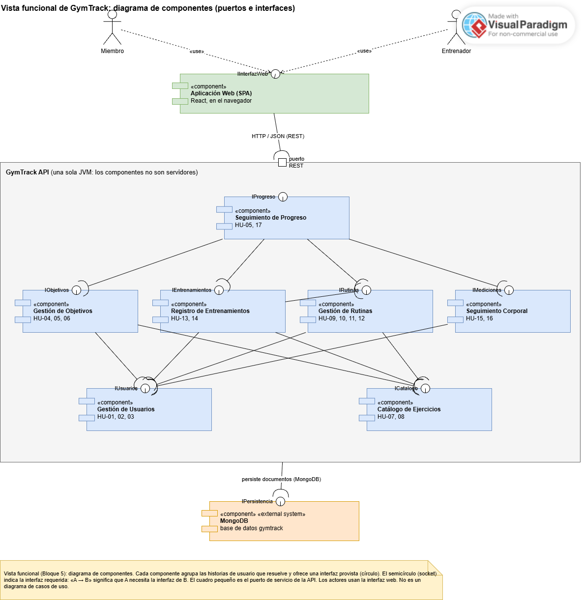
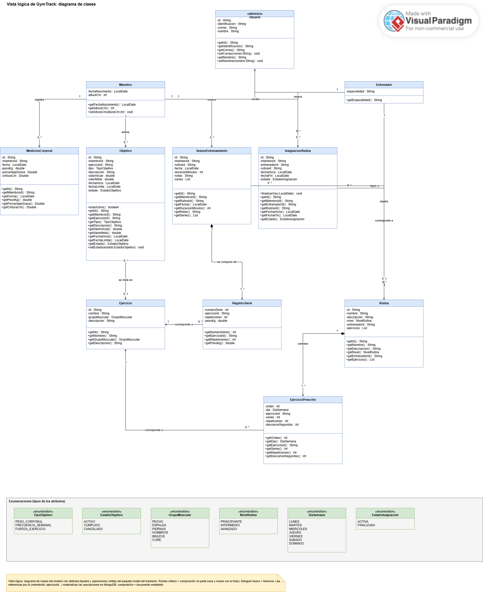
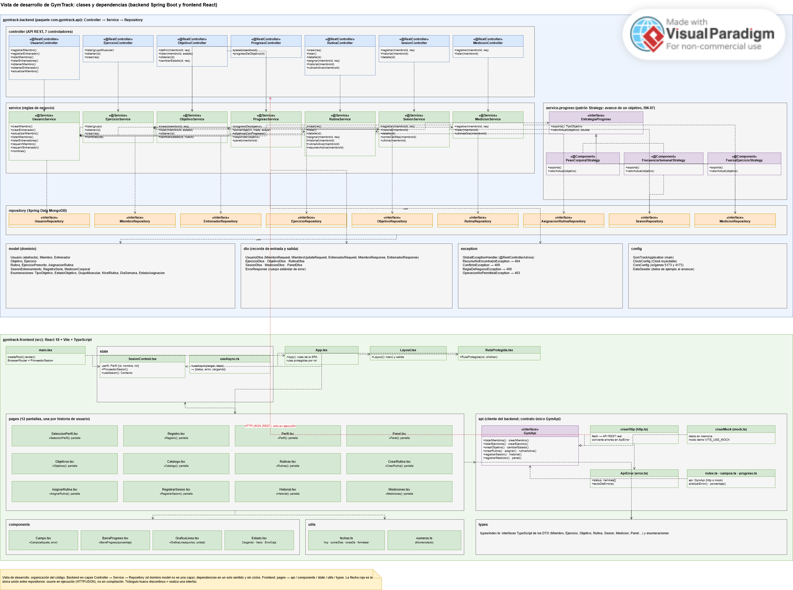
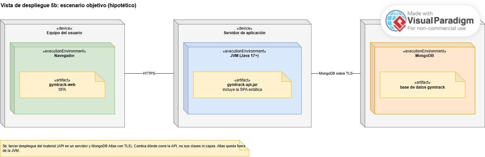

# Vistas arquitectónicas de GymTrack

Cinco vistas construidas en **Visual Paradigm** (`../diagramas/gymtrack.vpp`, 6 diagramas). Cada una responde una pregunta distinta,
se verifica contra las reglas de `00-reglas-de-la-materia.md` y se relaciona con las demás por trazabilidad (HU → componente → clase → artefacto).

> Las imágenes de `../diagramas/exportados/` se exportaron desde **Visual Paradigm Online** (plan gratuito), por eso llevan la marca de agua
> *Made with Visual Paradigm – for non-commercial use*. Los diagramas son editables en línea (ver `../diagramas/editables/`).

| # | Vista | Diagrama UML | Archivo |
|---|---|---|---|
| 1 | Contexto | Diagrama de contexto (sistema, entidades externas y flujos de datos) | `1-contexto.png` |
| 2 | Funcional | Componentes | `2-funcional.png` |
| 3 | Lógica | Diagrama de clases (nombre, atributos con tipo y operaciones) | `3-logica-clases.png` |
| 4 | Desarrollo | Clases y dependencias (backend y frontend) | `4-desarrollo.png` |
| 5 | Despliegue | Despliegue: **5a** demostración local y **5b** escenario objetivo | `5a-…png`, `5b-…png` |

---

## 1. Vista de contexto — ¿quién interactúa con el sistema?

* **Decisión:** GymTrack es una caja negra; solo se muestran los dos actores de las historias (**Miembro**, **Entrenador**) y nueve capacidades observables
  (con sus HU). Se expresa como **diagrama de contexto** (modelo de la presentación del profesor): el sistema es un círculo, las dos entidades externas son rectángulos y cada flecha etiquetada es un flujo de datos (con sus HU).
* **No aparecen** MongoDB ni Spring: son *solución tecnológica*, no contexto del negocio (Bloque 2: «Del dominio» vs. «Solución tecnológica»).
  Entran en las vistas funcional y de despliegue.
* **Fuera del contexto:** sin autenticación (decisión declarada en `01-caso-de-estudio.md`).
* ⚠️ El material no define esta vista formalmente: se usa UML estándar y la decisión queda declarada.

| Verificación | |
|---|---|
| Actores = los de las historias de usuario | ✔ |
| Sin estructura interna ni tecnología | ✔ |
| Cada flujo de datos cita sus HU (17 de 17 cubiertas) | ✔ |

## 2. Vista funcional — ¿qué partes funcionales forman la solución?

* **Siete componentes** cohesivos dentro de «GymTrack API (una sola JVM)»; cada uno agrupa las HU que resuelve (Bloque 5: de clases a componentes).
* **Dependencias** (cliente → proveedor): Progreso → {Objetivos, Entrenamientos, Rutinas, Mediciones}; Objetivos, Entrenamientos, Rutinas → {Usuarios, Catálogo};
  Entrenamientos → Rutinas (rutina opcional de una sesión, RN-14); Mediciones → Usuarios. El grafo es **acíclico**.
* **Límites del sistema:** SPA → API por *HTTP/JSON (REST)*; API → MongoDB (sistema externo, «persiste documentos»).
* El recuadro de la API lo deja explícito: **las capas lógicas no son servidores**; todo corre en una JVM.
* **Es un diagrama de componentes, no de casos de uso.** Cada componente expone una **interfaz** (círculo: `IObjetivos`, `IRutinas`…) y las flechas discontinuas indican que un componente *usa la interfaz* de otro. Los actores y las capacidades del negocio pertenecen a la vista de contexto (casos de uso), no a esta.
* Versión **editable** (formas nativas) en Visual Paradigm Online: ver `../diagramas/editables/`.

| Verificación | |
|---|---|
| Cada HU cae en un componente | ✔ (ver matriz abajo) |
| Responsabilidades de alto nivel, sin clases ni endpoints | ✔ |
| Sin ciclos entre componentes | ✔ |

## 3. Vista lógica — diagrama de clases

Un único diagrama con **todas las clases del modelo**; cada una muestra su **nombre, sus atributos con tipo de dato y sus operaciones**. Los miembros son los del paquete `model` del backend. La justificación de **cada multiplicidad** está en `03-modelo-de-dominio.md` (columna *Regla*).

* Herencia `Usuario ◁— Miembro/Entrenador` (RN-02) **sin multiplicidades**, triángulo hueco; `Usuario` es abstracta (cursiva).
* Composición (rombo relleno): `Rutina ◆— EjercicioPrescrito` (1..\*) y `SesionEntrenamiento ◆— RegistroSerie` (1..\*): la parte nace y muere con el todo (en MongoDB, documento **embebido**).
* 13 asociaciones **con nombre** que se leen como frase (*Miembro define Objetivo*), con flecha de navegabilidad. Las referencias por id (`miembroId`, `ejercicioId`…) son cómo MongoDB materializa esas asociaciones.
* Las **enumeraciones** (`TipoObjetivo`, `EstadoObjetivo`, `GrupoMuscular`, `NivelRutina`, `DiaSemana`, `EstadoAsignacion`) se agrupan aparte: son los tipos de los atributos.
* Las operaciones son las públicas de cada clase: consultas y las pocas con regla (`Objetivo.estaActivo()`, `AsignacionRutina.finalizar(hoy)`). La lógica de negocio vive en los servicios (`Controller → Service → Repository`; ver las vistas funcional y de desarrollo y `gymtrack-backend`).
* Sin agregación: ningún caso es "tiene pero no controla su existencia" distinto de una asociación.

## 4. Vista de desarrollo — ¿cómo se organiza el código?

* Dos repositorios de código: `gymtrack-backend` (Maven, `com.gymtrack.api`) y `gymtrack-frontend` (npm, `src/`). Un tercero (`gymtrack-docs`) no es código.
* Backend: `controller → service → repository → model`; `controller → dto`; `service → dto, exception`; `dto → model`. **Un solo sentido, sin ciclos**; `model` no depende de ninguna capa.
* `config` (CORS, reloj y carga de datos de ejemplo) depende de `service` para sembrar datos con las mismas reglas que los reales; nadie depende de `config`.
* Frontend: `pages → {api, components, state, types}`; `state → types`; `api → types`.
* Única unión entre repositorios: **en ejecución**, `api (frontend) → controller (backend)` por HTTP/JSON, no en compilación.
* Dependencias externas agrupadas como «library» (Spring Boot starters; React/Vite/TypeScript).
* Siguiendo el ejemplo del profesor, el diagrama muestra **clases reales con operaciones y dependencias discontinuas** (16 clases de servicio/controlador/estrategia, 9 repositorios, y los módulos del frontend), agrupadas por capa; `model`, `dto`, `exception` y `config` se listan como grupos.

## 5. Vista de despliegue — ¿dónde se ejecuta cada artefacto?

**5a. Escenario de demostración (real, el que se ejecuta):**

**5b. Escenario objetivo (hipotético, claramente identificado):**

* 5a corresponde al *primer despliegue* del material (todo en el computador); 5b al *tercero* (API en un servidor + MongoDB Atlas, TLS).
* Nodos `«device»`/`«node»` → entornos `«executionEnvironment»` (Node.js, navegador, JVM, MongoDB) → `«artifact»` (`gymtrack-web`, `gymtrack-api.jar`, base de datos).
* **Controller, Service y Repository NO son nodos**: corren juntos en `gymtrack-api.jar`.
* Cada ruta lleva **protocolo y puerto** (HTTP 4173, HTTP/JSON 8080, protocolo MongoDB 27017; HTTPS; MongoDB sobre TLS).
* Cambia *dónde* corre la API entre 5a y 5b, no sus clases ni capas (pregunta final del material).

| Lista de verificación del material | 5a | 5b |
|---|---|---|
| Corrección: los nodos son lugares de ejecución | ✔ | ✔ |
| Artefactos: se identifica qué se despliega (no una clase de dominio) | ✔ | ✔ |
| Comunicación: conexiones y protocolos coherentes | ✔ | ✔ |
| Coherencia con las capas y el escenario | ✔ | ✔ |
| Claridad; sin infraestructura no pedida (sin balanceadores ni contenedores) | ✔ | ✔ |
| Atlas fuera de la JVM; sin flechas de herencia entre servidores | — | ✔ |

---

## Trazabilidad: historia → componente → clases

| HU | Componente (vista 2) | Clases principales (vista 3) |
|---|---|---|
| HU-01, 02, 03 | Gestión de Usuarios | `Usuario`, `Miembro`, `Entrenador` |
| HU-04, 05, 06 | Gestión de Objetivos (+ Progreso para el avance) | `Objetivo`, `EstrategiaProgreso` |
| HU-07, 08 | Catálogo de Ejercicios | `Ejercicio` |
| HU-09, 10, 11, 12 | Gestión de Rutinas | `Rutina`, `EjercicioPrescrito`, `AsignacionRutina` |
| HU-13, 14 | Registro de Entrenamientos | `SesionEntrenamiento`, `RegistroSerie` |
| HU-15, 16 | Seguimiento Corporal | `MedicionCorporal` |
| HU-17 | Seguimiento de Progreso | `ProgresoService` (panel) |

Los endpoints de cada HU están en `05-contrato-api.md`.
