# Mockups de GymTrack

11 pantallas de media fidelidad (HTML + PNG) que cubren las 17 historias. Incluyen **estados de error y vacíos**, no solo el camino feliz.

| # | Pantalla | Historias |
|---|---|---|
| 01 | 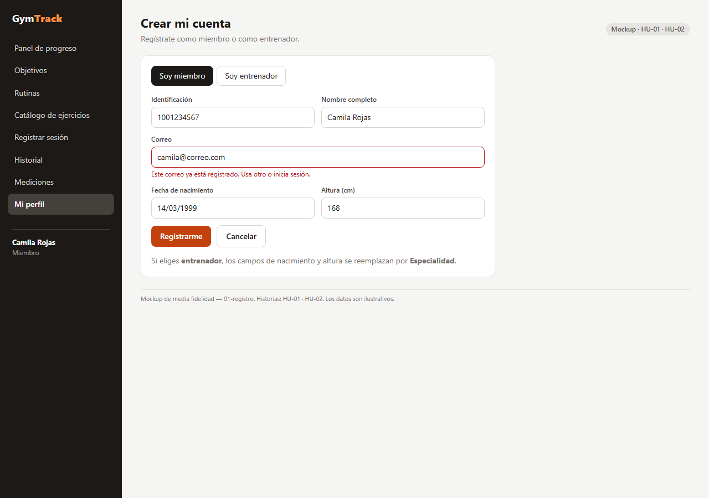 | HU-01 · HU-02 |
| 02 | 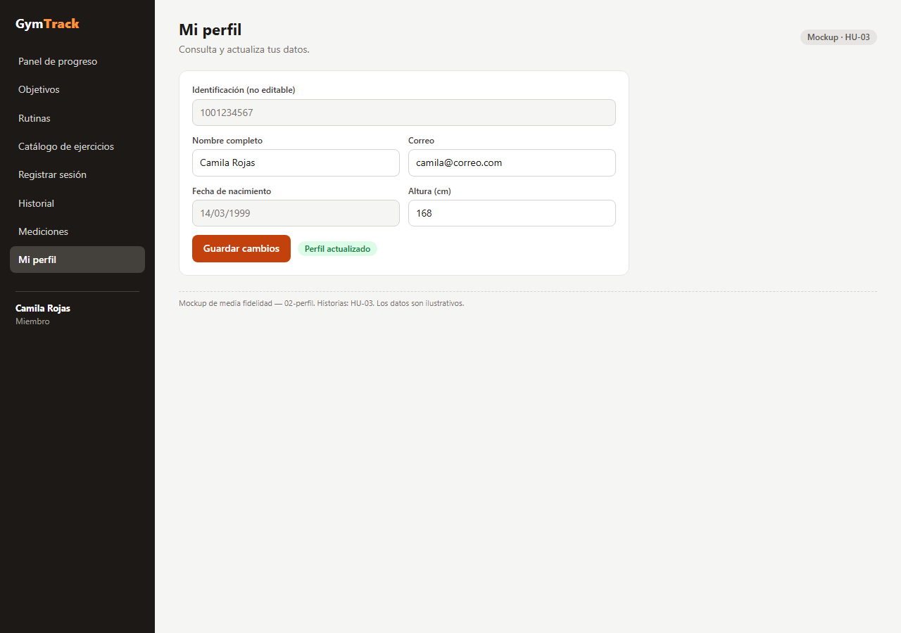 | HU-03 |
| 03 | 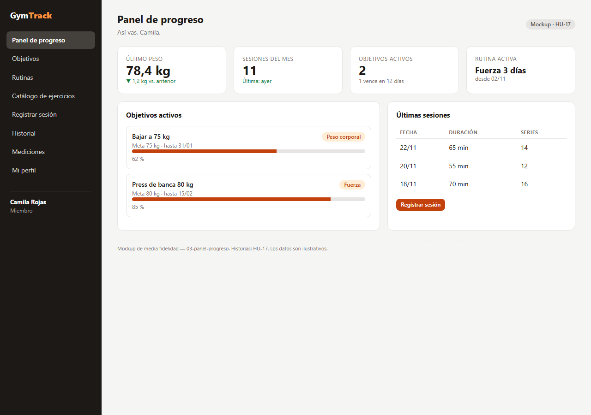 | HU-17 |
| 04 | 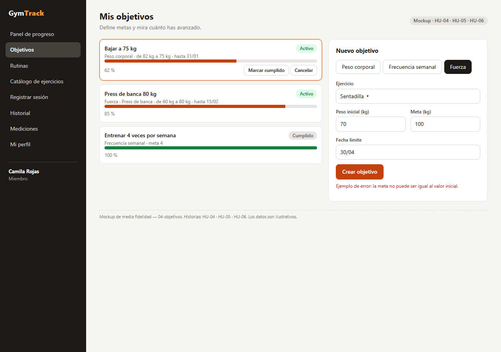 | HU-04 · HU-05 · HU-06 |
| 05 | 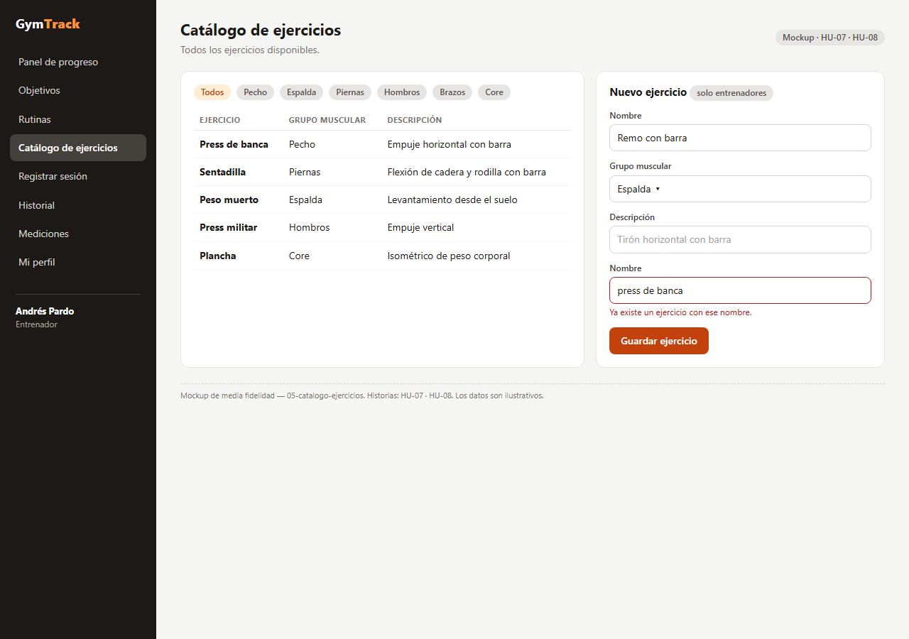 | HU-07 · HU-08 |
| 06 | 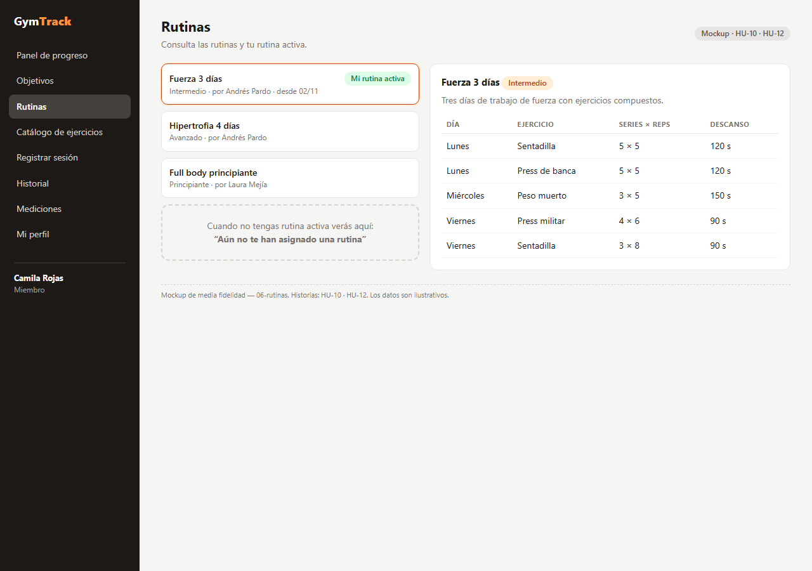 | HU-10 · HU-12 |
| 07 | 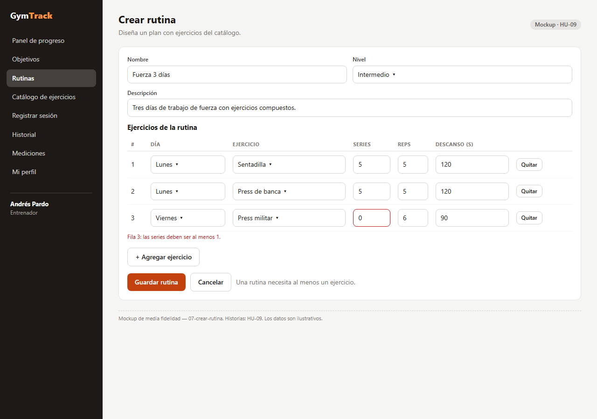 | HU-09 |
| 08 | 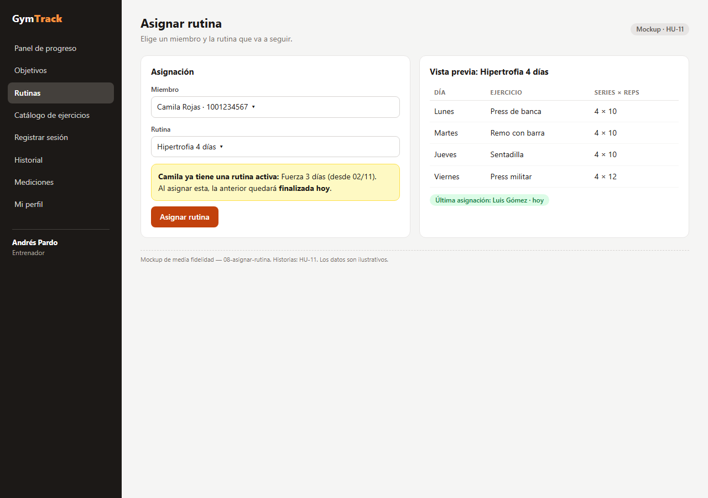 | HU-11 |
| 09 | 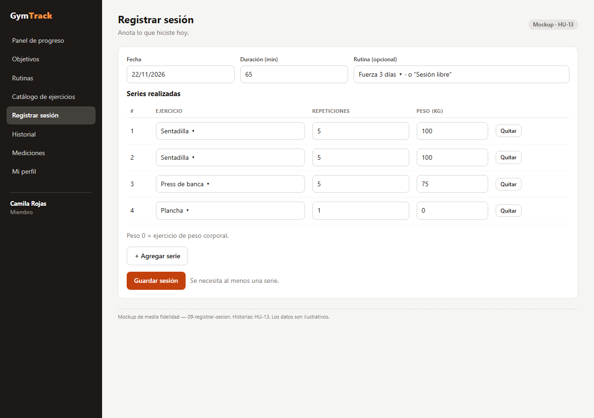 | HU-13 |
| 10 | 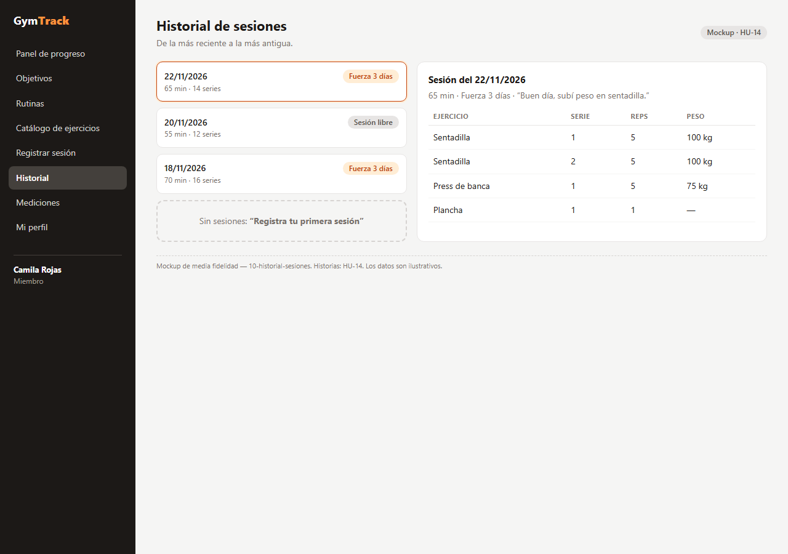 | HU-14 |
| 11 | 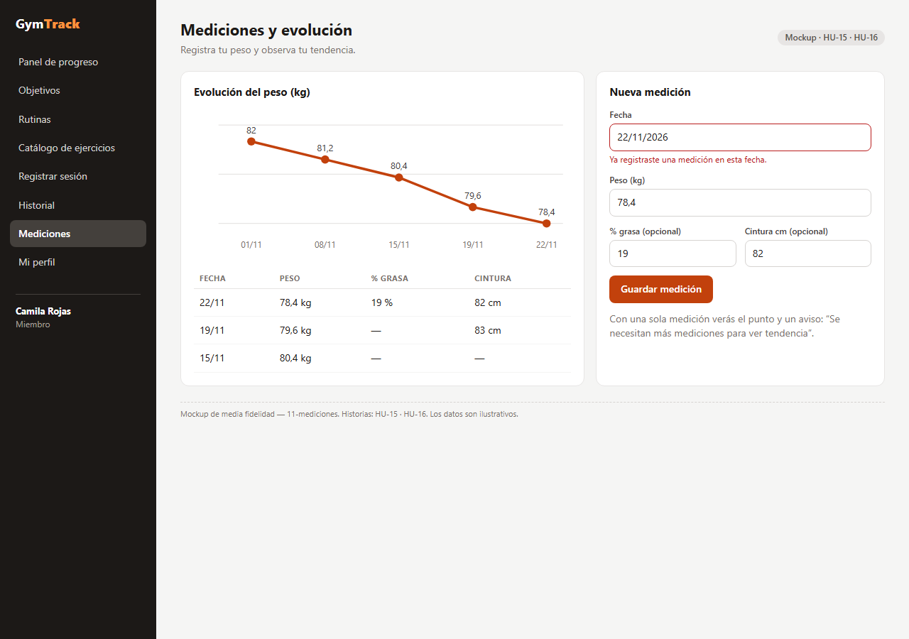 | HU-15 · HU-16 |

## Regenerar

Requiere Node y Microsoft Edge (o Chrome, pasando `-Edge`):

```powershell
cd mockups
node build.mjs     # genera html/ y assets/wireframe.css
./render.ps1       # exporta png/
```

El frontend de demo (`gymtrack-frontend`) implementa estas mismas pantallas.
